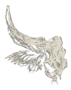

  

<h1 align="center">SAMOT Tools</h1>

Утилиты разработчика экосистемы <b>SAMOT</b>

---

### SAMOT Packager

Выбирает папку готовой игры и собирает релиз для GitHub Releases:
`pack-*.zip` с SHA-256 + `manifest.json` + короткая инструкция — в одну папку, готовую к загрузке на релиз.

**[Скачать SAMOT Packager 1.0.0 →](https://github.com/RevacholFrend/samot-tools/releases/latest/download/SAMOT-Packager.exe)**
Portable · ~72 МБ · Windows 10+ · ничего устанавливать не нужно

### Экосистема

- **[SAMOT Launcher](https://github.com/RevacholFrend/samot-launcher)** — лаунчер игр и ПО для игроков
- **[SAMOT Admin](https://github.com/RevacholFrend/samot-admin)** — панель администратора и разработчика
- **[revacholfrend.github.io](https://revacholfrend.github.io/)** — сайт проекта

Утилиты подписаны самоподписанным сертификатом SAMOT — при первом запуске Windows SmartScreen может показать предупреждение.
